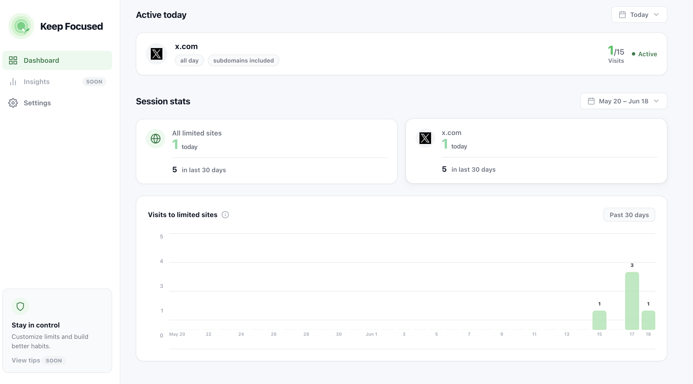

<p align="center">
  
</p>

<h1 align="center">Keep Focused</h1>

<p align="center">
  A lightweight Chrome extension for blocking distracting websites by domain, schedule, and daily session limits.
</p>

<p align="center">
  <a href="README.zh.md">Chinese README</a>
</p>

---

## Why Keep Focused?

Distraction is just one click away. **Keep Focused** helps you stay productive by putting simple, flexible rules between you and the sites that break your focus.

### Built for privacy

Most website blockers are made by third-party developers and require broad permissions to read every page you visit. That means a blocker can potentially see:

- Every URL you open
- When and how often you visit specific sites
- Your browsing habits over time

Some extensions send this data to remote servers for analytics, account syncing, or even monetization. Even well-known tools can change ownership or update their privacy policy at any time.

**Keep Focused exists because I wanted a blocker I could fully trust.** It is open-source, runs entirely inside your browser, and keeps all data — rules, usage, settings — in local Chrome storage. There is no account, no cloud sync, no analytics, and no remote server. If you can read the code, you know exactly what it does.

### Flexible, not restrictive

Instead of an all-or-nothing blocker, you decide:

- **Which domains** are distracting.
- **When** they should be blocked (specific days and times).
- **How often** you allow yourself to check them (daily session limits).

## Features

- 🔒 **Domain-based blocking** — Blocks by normalized domain, so `https://domain.com/path` and `https://www.domain.com` match the same rule.
- 🌐 **Subdomain support** — Optionally include subdomains like `forum.domain.com` per rule.
- 📅 **Scheduled rules** — Choose full blocking or daily session limits, select any of the seven days, and set all-day or custom hours. Open tabs are automatically blocked when a full-block schedule starts.
- 🔢 **Session limits** — Set a daily number of checking sessions. Repeated visits inside the same session window only count once.
- 💡 **Suggested domains** — Optionally rank your most visited domains over the last seven days and select one with a click. History is processed locally, only on request.
- 🏷️ **Rule type tags** — Saved rules clearly distinguish Time block from Session limit.
- 📊 **Accurate daily totals** — Tracks true daily session counts, including sessions used after resetting today's allowance.
- ⚡ **Master switch** — Quickly turn all blocking on or off from the popup.
- 🎯 **Timed focus mode** — Lock yourself to the current page for a chosen duration. It defaults to 30 minutes, can be changed in the popup or Settings, and automatically ends even when the popup is closed.
- 📑 **Optional tab limit** — Set a maximum number of regular-window tabs in Settings. New tabs beyond that limit close immediately; leave it blank for no limit.
- 🔒 **Privacy-first** — Everything stays in your browser; no accounts, no servers, no tracking.

## Showcase

<p align="center">
  
</p>

## Installation

1. Clone or download this repository.
2. Open Chrome and go to `chrome://extensions`.
3. Enable **Developer mode** (toggle in the top-right corner).
4. Click **Load unpacked**.
5. Select the project folder.
6. Open the extension settings and add your first rule.

## Usage examples

**Limit checking to 5 sessions on selected days**

| Domain | Days | Time | Sessions | Result |
|---|---|---|---|---|
| `tradingview.com` | Mon / Tue / Sun | All day | 5 | Allows five checking sessions on those days, then blocks until the next local day. |

**Block a site during work hours**

| Domain | Days | Time | Mode | Result |
|---|---|---|---|---|
| `reddit.com` | Mon–Fri | 08:00–18:00 | Completely block | Fully blocks Reddit during weekday work hours; allows it outside that window. |

In **Settings → Add rule**, choose **Completely block**, select the days (or use Weekdays / Weekends / Every day), then set the start and end times. New rules default to weekday blocking from 08:00 to 17:00. Use **Limit daily sessions** for a checking allowance instead.

Schedules repeat weekly using your computer’s local time. The start is inclusive and the end is exclusive. An overnight window belongs to its start day: Monday 22:00–08:00 ends Tuesday morning. Use **All day** for a whole day; custom start and end times must differ. Add multiple rules for the same domain to use different hours on different days. Any active full-block rule takes priority over session allowances. Existing zero-session rules remain full blocks.

Saving an active block also blocks matching open tabs. At the end of the schedule, you can revisit the site; blocked pages do not reopen automatically. Chrome may delay alarms while the computer is asleep; a periodic check rechecks open tabs when Chrome resumes.

## Development checks

See [AGENTS.md](AGENTS.md) for the agent-oriented architecture guide, storage contracts, privacy requirements, and release workflow. There is no build step; load the repository directly as an unpacked extension. Tests require Node.js 20 or newer.

```sh
TZ=America/Los_Angeles node --test tests/*.test.cjs
```

The tests cover weekly and overnight boundaries, daylight saving transitions, overlapping rules, background enforcement and tab limits with mocked Chrome APIs, and seven-day history aggregation. Mocked tests do not replace checking permission prompts and alarms in a loaded Chrome extension.

## Suggested domains

When adding or editing a rule, click **Show most visited · 7 days** and grant optional Chrome history access to see the ten most visited domains over the last 7 × 24 hours. Click a suggestion to fill the domain; saving the rule is still required.

Counts use individual visits within the time window, including reloads, rather than lifetime URL counts, time spent, or checking sessions. Different paths and `www` are merged; other subdomains stay separate. Queries are capped at 10,000 history URLs and show a partial-ranking notice if the cap is reached. Deleted history and incognito visits are unavailable.

History is queried on demand and processed locally. The extension never stores or uploads URLs, browsing history, or the suggestions. Declining permission still allows manual domain entry.

## Permissions

Keep Focused uses the minimum permissions needed to do its job:

- `history` (optional) — Read recent browsing history on request to compute local domain suggestions.
- `storage` — Save your rules and settings locally.
- `tabs` / `webNavigation` — Detect page navigation and count sessions.
- `alarms` — End a timed Focus mode at its scheduled time, even when the popup is closed.
- `notifications` — Notify you when Focus mode switches you back to the locked page (fallback when the popup cannot open automatically).
- `host_permissions: <all_urls>` — Read page URLs so rules can match any domain you choose.

## Releases

The current release is **1.2.0**. See [CHANGELOG.md](CHANGELOG.md) for release notes. Release tags use `vMAJOR.MINOR.PATCH` and are annotated tags pointing to the commit containing the matching manifest version. A Git tag does not publish the extension to the Chrome Web Store.

## License

MIT
